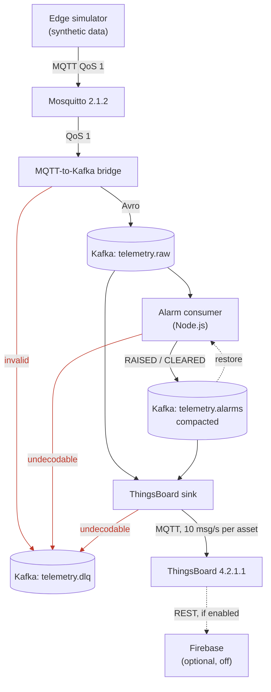
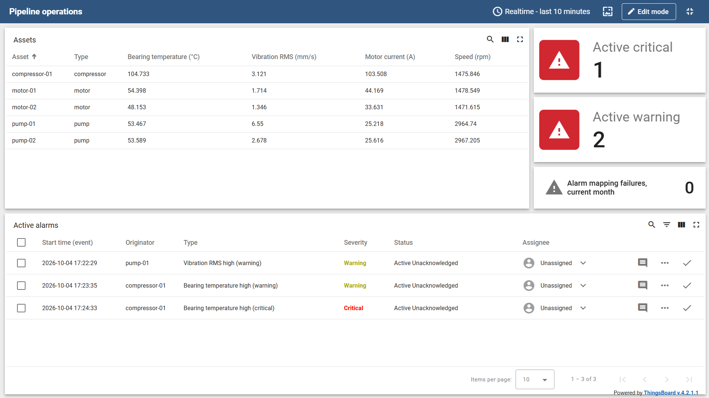
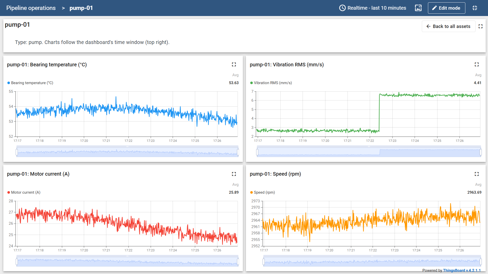
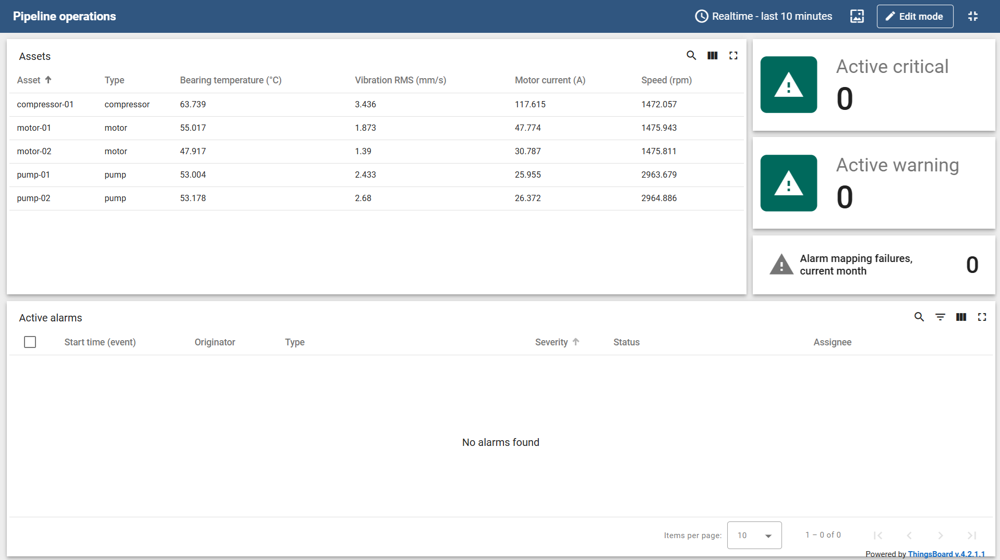

# industrial-telemetry-streaming-pipeline

[](https://github.com/anthoadc-AI/industrial-telemetry-streaming-pipeline/actions/workflows/ci.yml?query=branch%3Amain)

> **All data in this repository is synthetic.** The five machines, their telemetry, the injected faults and every
> alarm threshold are generated or chosen for a demonstration. Nothing was measured on a real machine, and every
> telemetry and alarm record carries `synthetic: true`.

A condition-monitoring pipeline for five rotating machines (two motors, two pumps, a compressor), run on one host
with Docker Compose. A simulator publishes bearing temperature, vibration, motor current and speed over MQTT. A
bridge validates each message and writes it to Kafka as Avro. An alarm consumer evaluates level alarms with
persistence and hysteresis. A sink forwards telemetry and alarm events to a ThingsBoard dashboard for operators.
Every figure below was measured on one laptop, with the conditions stated next to it.

## Architecture



- The bridge (Python) accepts only messages that validate against an Avro schema; anything else goes to a
  dead-letter topic intact, with a reason.
- Kafka orders each machine's records by keying them by asset; Avro schemas in Schema Registry are the contract
  between the Python and Node.js components.
- The alarm consumer (Node.js) is the only place where thresholds are evaluated. It rebuilds its state at start-up
  from the compacted `telemetry.alarms` topic.
- ThingsBoard displays telemetry and alarms; it maps alarm events, it does not decide them.
- What each hop guarantees, its failure modes and the design decisions are in
  [docs/ARCHITECTURE.md](docs/ARCHITECTURE.md).

## Measured figures

**Conditions.** One laptop: Docker Desktop on WSL 2 with 8 vCPUs, the services pinned to fixed vCPUs
(`config/benchmark.yaml`), every component on one host and one Docker network. Kafka is a single broker with
replication factor 1, writing to tmpfs. Synthetic messages of about 218 B. Each run measures a 300 s window; the five runs of each row are summarised as their median
and, in brackets, the range across runs, in whole milliseconds. These figures say nothing about separate machines,
real networks, a replicated disk-backed Kafka, or runs of hours.

| Figure | Rate | Runs | p50 ms | p95 ms | p99 ms | Samples per run |
|---|---|---|---|---|---|---|
| Sample to record read from Kafka (F1) | 50 msg/s | 5 | 7 (7-8) | 11 (11-12) | 13 (12-13) | 15000 |
| Sample to the alarm event acknowledged by Kafka (F2) | 50 msg/s | 5 | 35 (34-36) | 55 (52-56) | - | 300 |
| Sample to record read from Kafka (F1), at the sustained rate | 2000 msg/s | 5 | 6 (6-6) | 11 (10-16) | 26 (19-59) | 600000 |

- **Sustained throughput (F3): 2000 msg/s**, confirmed in 5 of 5 runs of 300 s, with the bridge logging every
  message at INFO, its default. The next step, 3000 msg/s, could not be measured validly: the load generator itself
  reached its CPU limit. No rate between the two was measured.
- **F1** starts at the sample's scheduled instant, so a stall of the load generator counts as pipeline latency.
  **F2** uses a fixed fault pattern and ends when Kafka acknowledges the alarm event, before ThingsBoard. Its 300
  samples per run are too few for a p99.
- **ThingsBoard is not in these figures.** Its path is limited to 10 msg/s per asset by configuration, and its
  latency and ceiling were not measured.

Source: `make bench-report`, which regenerates these tables from `bench/results/`, and the benchmark's
[closure report](docs/internal/phase3_task3.3_closure_report.en.md) (sections 1 and 4).

## What the benchmark and the review found and fixed

**Mosquitto dropped messages it had acknowledged.**
- *Problem.* With Mosquitto's defaults the queue for a subscriber held 1040 messages, measured. A bridge that fell
  behind for under a second lost messages, while the publisher still got its acknowledgement: 61,140 at 3000 msg/s.
- *Action.* A queue of 60,000 messages and 25 MiB, a drop monitor in the bridge, and two integration tests.
- *Result.* A paused bridge received 1,040 of 5,000 messages before and 5,000 of 5,000 after; no run of the final
  benchmark series had a drop.

**A healthcheck loaded the broker it was checking.**
- *Problem.* The Kafka and ZooKeeper healthchecks started a JVM about every 11 s, on the broker's pinned vCPUs.
- *Action.* Healthchecks without a JVM, compared idle over 300 s with the benchmark's own method.
- *Result.* The idle broker went from 18.0 % to 5.9 % of a core on average, and its samples at or above 50 % from
  17 to 1.

**Docker Desktop stopped containers after 1 s.**
- *Problem.* Docker Desktop's API proxy created every container with a 1 s stop timeout, against the engine's
  default of 10 s. The alarm consumer needs 1.5 to 3.6 s to stop, so it was killed mid-stop.
- *Action.* An explicit `stop_grace_period` for every service: 30 s for the pipeline containers.
- *Result.* Every service exits 0 or 143 (the JVM's exit on SIGTERM), none by SIGKILL, except ThingsBoard, whose
  start script ignores SIGTERM. A test requires a clean exit from each pipeline container.

**A restart could clear an alarm that was still active.**
- *Problem.* After a stop between an alarm send and its offset commit, the replayed samples could clear an alarm
  restored as active. ThingsBoard then showed it cleared while the condition held.
- *Action.* A replay guard: each alarm ignores samples stamped at or before its latest event.
- *Result.* `test_replay_before_the_raise_does_not_clear_the_restored_alarm` and its ThingsBoard counterpart fail on
  the code before the fix and pass on the code after it.

**A replay could raise a phantom alarm.**
- *Problem.* In the same situation, an alarm already cleared was raised again under a new id and cleared at once:
  an extra alarm in ThingsBoard. Found while fixing the previous defect.
- *Action.* The same guard, with the state restored from each alarm's latest event, cleared ones included.
- *Result.* `test_replay_of_a_clear_does_not_raise_a_phantom_alarm` fails on the code before the fix and passes on
  the code after it.

## How to run it

**Requirements.** Docker with Compose v2 (Docker Desktop on Windows), Python 3.13 (`.python-version` pins 3.13.4),
Node.js 24 (`.nvmrc` pins 24.16.0) and GNU Make. The targets run from Git Bash or PowerShell on Windows and from bash
on Linux.

Copy `.env.example` to `.env` and set `TB_TENANT_PASSWORD` and `TB_SYSADMIN_PASSWORD` to the ThingsBoard CE public
defaults that the file names (`tenant` and `sysadmin`).

```
make install           # .venv, Python and npm dependencies, git hooks
make test              # unit tests of both languages, with coverage; no containers needed
make up-pipeline       # stack, topics, ThingsBoard rule chains and dashboard, and the pipeline in containers
make smoke-containers  # 200 messages end to end against the pipeline in containers; needs an empty telemetry.raw
make down              # stop everything; named volumes are kept
```

- **`make up-pipeline`** starts everything, including the bridge, the alarm consumer and the ThingsBoard sink in
  containers. Use it to run the pipeline.
- **`make up`** starts the stack only (Mosquitto, Kafka, Schema Registry, ThingsBoard), provisioned. Use it when
  the pipeline processes run on the host, for development.

**Live data on the dashboard.** With the pipeline running, start the simulator with the two faults of the captures
below. The `:300` in each `--fault` injects the fault 300 s after the simulator starts, so the charts show the step:

```
# on the host (Windows: ./.venv/Scripts/python.exe)
.venv/bin/python -m edge.simulator --fault pump-01:imbalance:300 --fault compressor-01:bearing_overheating:300

# or as a container, after make up-pipeline
docker compose --profile simulator run --rm simulator --fault pump-01:imbalance:300 --fault compressor-01:bearing_overheating:300
```

Open ThingsBoard at `http://localhost:8080` (`TB_HTTP_PORT` in `.env`), sign in as `tenant@thingsboard.org`, and
open the dashboard "Pipeline operations". A fault stays applied until the simulator stops: stop it (Ctrl+C) and
start it again without `--fault` to see the alarms clear.

## Dashboard

Captured on 2026-10-04 from the synthetic data, with the same two faults.



*The plant view with faults active: pump-01 vibration at WARNING (imbalance), compressor-01 bearing temperature at
WARNING and CRITICAL (overheating). The cards count active alarms by severity, and mapping failures.*



*pump-01's four channels over ten minutes. The imbalance fault is a step of 4 mm/s in vibration, to about
6.5 mm/s; temperature, current and speed follow their normal drift.*



*The plant after the faults stop: every alarm cleared by the alarm consumer, none active.*

## Alarm logic

- Each alarmed channel has two independent level alarms, HI (warning) and HIHI (critical), in the style of
  ANSI/ISA-18.2. An alarm raises after a number of consecutive samples at or above its threshold and clears after
  the same number below the threshold minus a deadband (persistence and hysteresis, in `config/alarms.yaml`).
- The vibration thresholds, 4.5 and 7.1 mm/s RMS, coincide with the B/C and C/D zone boundaries that
  [ISO 20816-3](https://www.iso.org/standard/78311.html) (external link) gives for Group 2 machines on flexible
  supports. They were not derived from an assessment of these synthetic machines; the temperature and current
  thresholds are illustrative.
- Each fault changes one channel: `imbalance` steps vibration, `bearing_overheating` ramps bearing temperature.
  Details in [section 6 of the architecture document](docs/ARCHITECTURE.md#6-alarm-logic).

## Verification

CI runs four jobs on GitHub Actions: lint and unit tests, integration tests on the core stack, the pipeline in
containers with the smoke run, and, on main, integration tests with ThingsBoard. Run 38472910691 on main at `c576f2b`,
2026-10-13, passed all four:

- unit tests: 447 Python, 119 Node.js;
- integration tests: 16 passed and 16 skipped on the core stack (the skipped ones need ThingsBoard), 32 passed on
  the full stack;
- Python coverage, as printed: "Total coverage: 98.54%" (coverage.py, statements and branches together) and
  "845/874 branches, 96.68 %" (`scripts/check_branch_coverage.py`);
- Node.js coverage: lines 100 % (1159/1159), branches 98.7 % (305/309).

Lines and branches must each stay at or above 80 % per language. Which test backs which guarantee is listed in
[section 11 of the architecture document](docs/ARCHITECTURE.md#11-verification).

## Known limitations

- **One host, no high availability.** One Kafka broker with replication factor 1 on tmpfs, so a broker restart
  empties every topic; one Mosquitto, one ThingsBoard, one alarm consumer.
- **No security.** MQTT is anonymous, Kafka is PLAINTEXT, there is no TLS.
- **Before the bridge receives a message, delivery is at most once.** Messages published while the bridge is down
  are acknowledged to the publisher and lost.
- **The path to ThingsBoard is limited to 10 msg/s per asset,** and its latency and capacity were not measured.
- **The replay guard trusts the producers' clocks.** A clock that goes back makes an alarm ignore that machine's
  samples until time passes its latest event; the skipped samples are counted.

The full list is in [section 13 of the architecture document](docs/ARCHITECTURE.md#13-known-limitations).

## Origin

The project started from the coursework of MIT xPRO Data Engineering, Module 24, "Handling Big Data with
Mosquitto, ThingsBoard, and Kafka", preserved unchanged at the tag `v0-coursework`, and was rebuilt from there.
The project was executed with an AI coding agent (Claude Code) from written briefings kept in `docs/internal/claude_code_briefings/`; the design decisions, the reviews and the approval of every checkpoint were the author's.

## Why this matters

A rotating machine that degrades shows it in signals a plant already collects: vibration, bearing temperature,
motor current. What decides whether anyone acts in time is the path from the sensor to the
operator: whether every sample arrives, in order, and whether an alarm means what it says. This repository is that
path at small scale, with its guarantees written down, measured where they can be, and tested where they could fail.
The [case study](docs/CASE_STUDY.md) discusses what it would take to apply it to a real plant.

## License

MIT, see [LICENSE](LICENSE).
