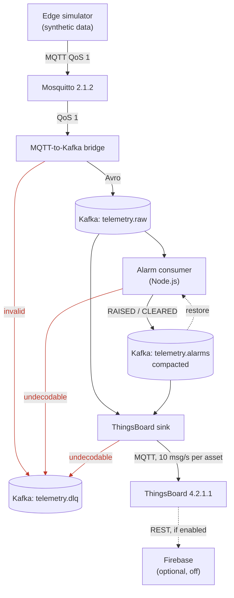
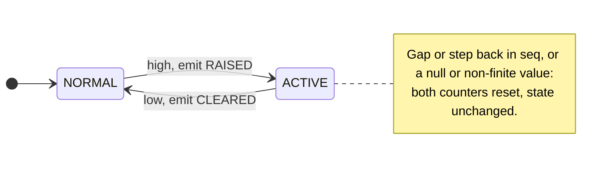
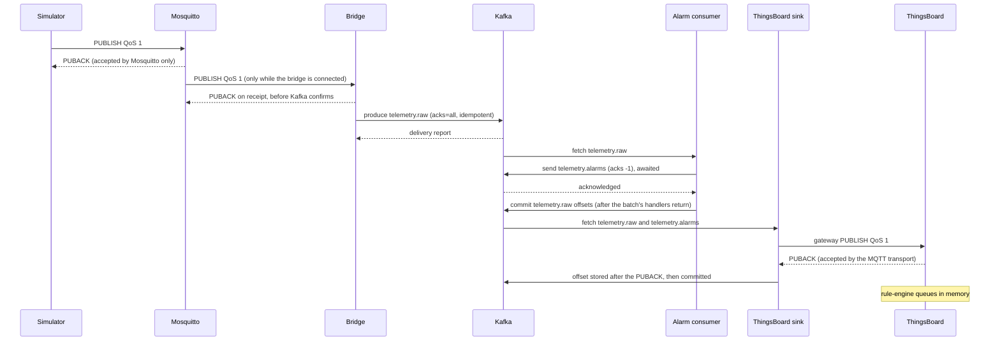

# Architecture

> **All data in this repository is synthetic.** The assets, their telemetry, the injected faults and every
> threshold are generated or chosen for a demonstration. Nothing describes or was measured on a real machine.
> Every telemetry and alarm record carries `synthetic: true`.

This document describes an industrial telemetry pipeline that runs on one host. A simulator publishes condition-monitoring telemetry for five machines over MQTT. A bridge validates it and writes it to Kafka as Avro. An alarm consumer evaluates level alarms with persistence and hysteresis. A sink forwards telemetry and alarm events to ThingsBoard for operators.

The document covers what each part does, how data moves, what is guaranteed at each hop, what is not, and why. Every statement about behaviour points to code, configuration or a test in this repository. The traceability table `docs/internal/phase3_task3.4_traceability.md` lists the evidence for each one. This document contains no performance figures: values below are configuration values, read from `config/` and `docker-compose.yml`.

**About the internal documents.** The project was built in phases (Phase 0 to Phase 3). The reports, briefings and backlog of those phases are under `docs/internal/`. Most Phase 3 documents there are in Spanish; the Phase 0 to Phase 2 documents and the backlog `docs/internal/phase3_backlog.md` are in English. Where this document cites them as evidence, it gives the file path.

## Contents

1. [Scope and synthetic data](#1-scope-and-synthetic-data)
2. [System at a glance](#2-system-at-a-glance)
3. [Components](#3-components)
4. [End-to-end data flow](#4-end-to-end-data-flow)
5. [Topics and schemas](#5-topics-and-schemas)
6. [Alarm logic](#6-alarm-logic)
7. [Delivery guarantees, hop by hop](#7-delivery-guarantees-hop-by-hop)
8. [Failure modes](#8-failure-modes)
9. [Configuration and deployment](#9-configuration-and-deployment)
10. [Observability](#10-observability)
11. [Verification](#11-verification)
12. [Design decisions](#12-design-decisions)
13. [Known limitations](#13-known-limitations)
14. [Firebase (optional, inherited from the course)](#14-firebase-optional-inherited-from-the-course)

## 1. Scope and synthetic data

**What the system is.**
- A local pipeline on one host, started with Docker Compose.
- One Kafka broker with replication factor 1, one Mosquitto broker and one ThingsBoard instance.
- It started from the coursework of MIT xPRO Data Engineering, Module 24, "Handling Big Data with Mosquitto, ThingsBoard, and Kafka", preserved at the tag `v0-coursework`. That tag holds the three course folders as found: a Mosquitto broker stack; a ThingsBoard stack with a paho-mqtt publisher of random temperature and humidity values (its rule chains, which forwarded to Firebase, lived in the ThingsBoard database and are not in the tag); and a Confluent Platform 6.1.1 stack with a Python producer of vehicle coordinates and a Node.js kafkajs consumer. The pipeline described here was rebuilt from that starting point; section 12 says what was kept from it.
- `bench/` is the benchmark harness used to measure the pipeline. It is not part of the pipeline. Its results are in `bench/results/` and its report is `docs/internal/phase3_task3.3_closure_report.en.md`.

**What it is not.**
- Not a production deployment. There is no authentication on MQTT (`allow_anonymous true` in `broker/mosquitto/mosquitto.conf`), no TLS, and Kafka listeners are PLAINTEXT (`docker-compose.yml`).
- Not highly available: every component is a single instance.

**What is synthetic.**
- Five assets: `motor-01`, `motor-02`, `pump-01`, `pump-02`, `compressor-01`. Each has a physical model (load, electrical, thermal, vibration, noise and slow degradation) in `config/telemetry.yaml`, evaluated by `edge/simulator/model.py`.
- Four channels: `bearing_temperature_c`, `vibration_rms_mm_s`, `motor_current_a`, `speed_rpm`.
- Two injectable fault modes in `config/telemetry.yaml`:
  - `bearing_overheating`: a ramp on bearing temperature;
  - `imbalance`: a step on vibration.
- Alarm thresholds in `config/alarms.yaml`, chosen for this synthetic data. The temperature and current thresholds are illustrative; the vibration thresholds coincide with zone boundaries of a published standard (section 6).
- Two fields carry this through the pipeline:
  - `synthetic` is set on every telemetry and alarm record;
  - `injected_fault` names the fault the simulator applied to a sample (simulation ground truth).

## 2. System at a glance

- **Reading the diagram.** The three cylinders are topics on one Kafka broker (`cp-server` 6.1.1), with Avro schemas in Schema Registry; keys, partitions and retention are in section 5. Red edges carry dead letters. Dotted edges are the state restore at start-up and the optional Firebase leg (`FIREBASE_ENABLED=true`, section 14). Each component's code path is in section 3.
- **Simulator to Mosquitto.** One JSON message per asset and sample cycle, on `plant/<asset_id>/telemetry`, QoS 1.
- **Mosquitto to bridge.** The bridge subscribes to `plant/+/telemetry` with a clean session.
- **Bridge to Kafka.** Valid messages become Avro records on `telemetry.raw`, keyed by `asset_id`, produced with `acks=all`. Invalid ones go to `telemetry.dlq` intact, with a reason.
- **Kafka to alarm consumer.** The consumer reads `telemetry.raw`, runs the alarm state machines, and writes RAISED and CLEARED events to `telemetry.alarms`. At start-up it rebuilds its active alarms from that topic.
- **Kafka to ThingsBoard.** The sink reads both topics in its own consumer group and publishes to ThingsBoard's gateway MQTT API. There, the AlarmMapping rule chain turns alarm events into ThingsBoard alarms.

## 3. Components

| Component | Language | Code | Runs as | Reads | Writes |
|---|---|---|---|---|---|
| Edge simulator | Python 3.13.4 | `edge/simulator/` | host process, or `docker compose run` (profile `simulator`) | `config/telemetry.yaml` | MQTT `plant/<asset_id>/telemetry` |
| Mosquitto | — | `broker/mosquitto/mosquitto.conf` | compose, core | MQTT | MQTT |
| MQTT-to-Kafka bridge | Python 3.13.4 | `bridge/mqtt_to_kafka/` | host process, or container (profile `pipeline`) | MQTT `plant/+/telemetry` | `telemetry.raw`, `telemetry.dlq` |
| Kafka, ZooKeeper, Schema Registry | — | `docker-compose.yml`; topics by `broker/kafka/provision.py` | compose, core | — | — |
| Alarm consumer | Node.js 24.16.0 | `processing/alarm_consumer/` | host process, or container (profile `pipeline`) | `telemetry.raw`; `telemetry.alarms` at start-up | `telemetry.alarms`, `telemetry.dlq` |
| ThingsBoard sink | Python 3.13.4 | `processing/thingsboard_sink/` | host process, or container (profile `pipeline-tb`) | `telemetry.raw`, `telemetry.alarms` | ThingsBoard gateway MQTT API; `telemetry.dlq` |
| ThingsBoard | — | `processing/thingsboard/` (rule chains, dashboard), set up by `scripts/thingsboard/import_rule_chains.py` | compose, profile `full` | gateway MQTT | alarms, time series, dashboard |
| Shared configuration | Python, Node.js | `config/loader.py`, `processing/alarm_consumer/config_loader.js` | library | `config/*.yaml` | — |
| Shared JSON logging | Python, Node.js | `common/jsonlog.py`, `common/jsonlog.js` | library | — | stderr |

- **Where configuration lives.** Topic names, thresholds and limits are read from `config/` by both languages. A cross-language test keeps the two loaders equal (`tests/unit/test_alarm_config_equivalence.py`).
- **Topic override.** `TELEMETRY_TOPIC` can rename `telemetry.raw`. Nothing else in `config/topics.yaml` can be overridden.

## 4. End-to-end data flow

How one sample travels:

1. **Simulator.**
   - Each cycle publishes one message per asset. The default rate is one cycle per `sample_interval_s` (1.0 s in `config/telemetry.yaml`).
   - Each message is a JSON object with `asset_id`, `asset_type`, `seq` (per asset), `ts` (ISO 8601 UTC), `synthetic`, the four channels and `injected_fault`.
2. **Mosquitto.** The broker accepts the QoS 1 publish and acknowledges it, then queues it for the bridge (section 7).
3. **Bridge, validation.** `bridge/mqtt_to_kafka/validation.py` accepts a payload only if all six of these hold:
   1. it is UTF-8 JSON encoding an object;
   2. `ts` is ISO 8601 with a UTC offset;
   3. it has no field the schema does not define;
   4. it validates against `schemas/telemetry_v1.avsc`;
   5. no number is NaN or infinite;
   6. `asset_id` matches the asset in the MQTT topic.

   There is no range check, because `config/telemetry.yaml` defines units but no physical limits.
4. **Bridge, produce.**
   - A valid payload is serialised to Avro through Schema Registry and produced to `telemetry.raw`, keyed by `asset_id`.
   - A payload that fails validation or serialisation is produced intact to `telemetry.dlq` (`dlq_v1`), keyed by the asset named in the MQTT topic. Reason codes: `invalid_json`, `invalid_ts`, `schema_mismatch`, `non_finite_value`, `topic_mismatch`, `serialization_error`.
5. **Alarm consumer.** It decodes each record and feeds it to the state machines of that asset (section 6). It produces every transition to `telemetry.alarms` before the record's offset is committed.

   Two kinds of record go to `telemetry.dlq` instead:
   - permanently undecodable: no wire-format header, a schema id the registry does not know, or bytes that do not decode;
   - decoded but without the fields the state machines need (`missing_field`).
6. **ThingsBoard sink.**
   - A telemetry record becomes one time-series entry on the asset's device, stamped with the sample's own `ts`.
   - An alarm event becomes one entry under the key `alarm_<channel>_<severity>`. Its value is the event as JSON, including `raised_ts` taken from the `alarm_id`.
   - Each asset is a ThingsBoard device. ThingsBoard creates it on first use with the asset's type, so it gets the device profile the import script made for that type.
7. **ThingsBoard.**
   - The Root Rule Chain saves the telemetry and passes every saved message to AlarmMapping.
   - AlarmMapping evaluates no threshold. It applies a RAISED or CLEARED event only if the event belongs to a newer alarm than the last one applied for that device and alarm type, or if it is the CLEARED of that same alarm. Anything else is dropped as a replay. The last applied event per type is kept in the server attribute `alarm_last` (`processing/thingsboard/rule-chains/alarm-mapping.json`).

## 5. Topics and schemas

### Topics

Every topic is created by `broker/kafka/provision.py` from `config/topics.yaml`. Automatic topic creation is off (`KAFKA_AUTO_CREATE_TOPICS_ENABLE: "false"`), and no component creates topics itself.

| Topic | Key | Partitioned by | Partitions | Replication factor | Topic-level settings | Value schema |
|---|---|---|---|---|---|---|
| `telemetry.raw` | `asset_id` | key (default partitioner) | 3 | 1 | none | `schemas/telemetry_v1.avsc` |
| `telemetry.alarms` | `alarm_id` | `asset_id` (`AssetPartitioner`) | 3 | 1 | `cleanup.policy=compact` | `schemas/alarm_v1.avsc` |
| `telemetry.dlq` | `asset_id` when known; `alarm_id` for the sink's dead letters | — | 1 | 1 | `cleanup.policy=delete`, `retention.ms=604800000` | `schemas/dlq_v1.avsc` |

**Broker defaults in effect.** The settings below are not set anywhere in this repository. They are the broker's defaults, read from the running broker with `kafka-configs --describe --all` on Confluent Platform 6.1.1, and they apply to `telemetry.raw` and `telemetry.alarms`:

| Setting | Value in effect |
|---|---|
| `retention.ms` (`telemetry.raw`) | 604800000 (7 days) |
| `segment.ms` | 604800000 (7 days) |
| `segment.bytes` | 1073741824 |
| `min.cleanable.dirty.ratio` | 0.5 |
| `delete.retention.ms` | 86400000 |
| `log.cleaner.backoff.ms` (broker) | 15000 |

Kafka keeps its data on tmpfs (section 9). Whatever the retention, the topics are empty after the broker container restarts.

### The contract of `telemetry.alarms`: keyed by alarm, partitioned by asset

The alarm consumer's producer uses `AssetPartitioner` (`processing/alarm_consumer/consumer.js`):
- **The key stays the `alarm_id`.** Compaction and the state restore need it: the topic keeps at least the latest event per alarm.
- **The partition is the murmur2 partition of the `asset_id`,** the key's first segment. This is the same partition a Java or librdkafka producer keyed by `asset_id` would choose.
- **Why.** Kafka orders records only within a partition. AlarmMapping must see an asset's alarm events in production order, because it drops an event that is older than the last one it applied.
- **The default partitioner breaks this.** It partitions by the whole `alarm_id`, which spreads one asset's alarms over partitions, so a lagging or replaying reader drops older alarms.
- **This applies to every producer.** Any other producer writing to `telemetry.alarms` must partition the same way.
- **Dead letters.** The consumer's dead letters use the same partitioner. They are keyed by `asset_id`, which is its own first segment.
- **Tested by** `tests/integration/test_alarm_partitioning.py`.

### Compaction does not bound the topic's size by time

The log cleaner never compacts the active segment, and the broker checks `segment.ms` only when it appends to a partition. On `telemetry.alarms` this has two consequences:
- The RAISED record of a cleared alarm is removed only after another record lands in the same partition and closes the segment that holds the CLEARED.
- On a partition with no further writes, the RAISED/CLEARED pair stays indefinitely.

This does not affect correctness: readers keep the latest event per `alarm_id`, and the restore reads the CLEARED. The settings that govern it are `segment.ms`, `min.cleanable.dirty.ratio` and `log.cleaner.backoff.ms`, all broker defaults here (table above).

`tests/integration/test_restore_compaction.py` tightens them for that test only, so the cleaner runs within the test. It then rolls every partition and checks that the restore reads the compacted log.

### Schemas

| Schema | Record | Topic | Producers |
|---|---|---|---|
| `schemas/telemetry_v1.avsc` | `industrial_telemetry.Telemetry` | `telemetry.raw` | bridge |
| `schemas/alarm_v1.avsc` | `industrial_telemetry.Alarm` | `telemetry.alarms` | alarm consumer |
| `schemas/dlq_v1.avsc` | `industrial_telemetry.DeadLetter` | `telemetry.dlq` | bridge, alarm consumer, ThingsBoard sink |

- **Registration.** Producers register their schemas under `<topic>-value`.
- **Compatibility.** The global level is `BACKWARD`, set and read back by `broker/kafka/provision.py`.
- **Versioning policy** (`schemas/README.md`):
  - a backward-compatible change evolves the file in place;
  - a breaking change gets a `_v2` file and a new topic;
  - record names and namespaces never change;
  - enums carry a `default`.
- **Known gap.** The `doc` of the `source` field in `dlq_v1` names only the bridge and the alarm consumer, although the ThingsBoard sink also writes dead letters (`source: thingsboard_sink`). The schema file is unchanged so as not to register a new version for a comment. This is listed in section 13.

## 6. Alarm logic

The engine is `processing/alarm_consumer/state_machine.js`, and its thresholds come from `config/alarms.yaml`. ThingsBoard evaluates no threshold.

### Two level alarms per channel

Each rule `(asset_id, channel)` has two independent level alarms, in the style of ANSI/ISA-18.2 absolute high alarms:
- HI, at the `warning` threshold;
- HIHI, at the `critical` threshold.

Each one has its own state and its own `alarm_id`. A value above both raises WARNING and then CRITICAL, and each clears at its own threshold.

### Thresholds

| Channel | Warning | Critical | Hysteresis | Persistence (samples) |
|---|---|---|---|---|
| `bearing_temperature_c` | 80.0 | 95.0 | 3.0 | 3 |
| `vibration_rms_mm_s` | 4.5 | 7.1 | 0.3 | 5 |
| `motor_current_a` | per asset | per asset | 1.0 | 5 |

`motor_current_a` thresholds are set per asset, at 105 % and 120 % of rated current:

| Asset | Warning | Critical |
|---|---|---|
| `motor-01` | 57.75 | 66.0 |
| `motor-02` | 42.0 | 48.0 |
| `pump-01` | 31.5 | 36.0 |
| `pump-02` | 31.5 | 36.0 |
| `compressor-01` | 126.0 | 144.0 |

The vibration thresholds, 4.5 and 7.1 mm/s RMS, coincide with the B/C and C/D zone boundaries that ISO 20816-3 (formerly ISO 10816-3) gives for Group 2 machines (15 kW to 300 kW) on flexible supports. No source was recorded when they were chosen, and they were not derived from an assessment of these synthetic assets, whose power rating and support type the repository does not define; on rigid supports the same standard gives 2.8 and 4.5 mm/s. The temperature and current thresholds are illustrative values.

`speed_rpm` is not alarmed.

### States

- **Transitions.**
  - *High:* the value is at or above the threshold for `persistence_samples` consecutive samples. The alarm becomes ACTIVE and RAISED is emitted.
  - *Low:* the value is below the threshold minus the hysteresis for `persistence_samples` consecutive samples. The alarm returns to NORMAL and CLEARED is emitted.
  - A gap in `seq`, `seq` going back, or a null or non-finite value resets both counters and never changes the state.
- **Persistence** is an on-delay and off-delay counted in samples. **Hysteresis** is a deadband in the channel's unit.
- **No time-based behaviour.** There is no debounce in time and no periodic clean-up: an alarm stays ACTIVE until its clear condition holds.
- **`alarm_id`** is `<asset_id>/<channel>/<severity>/<ts of the RAISED sample, epoch ms>`. It is deterministic: processing the same samples again yields the same id.

### State restore at start-up

**What is rebuilt.** Before consuming, the alarm consumer reads `telemetry.alarms` from the beginning up to the end offsets taken at start, with a limit of 60 s (`readActiveAlarms`, `processing/alarm_consumer/consumer.js`):
- it keeps the latest event per key (a tombstone deletes the key);
- it marks as ACTIVE every alarm whose latest event is RAISED (`restoreActive`, `state_machine.js`);
- it logs `alarms_restored`;
- a restored alarm that no configured rule matches any more is logged as `restored_alarm_without_rule`.

**What is not rebuilt.**
- The persistence counters and the last `seq` of each asset are not rebuilt. Consumption resumes at the group's committed offset on `telemetry.raw`, with the counters at zero.
- A run of samples that began before that offset is counted again from there. A raise or clear in progress at the stop can therefore come up to `persistence_samples − 1` samples later than it would have without the restart. This is read from the code; no test measures it.

### Known defect: a spurious CLEARED after a restore and a replay

**When it happens.** The consumer's offsets are committed after the handlers of a fetched batch return. If the consumer stops between sending a RAISED and that commit, two things are left behind:
- the RAISED is in `telemetry.alarms`;
- the committed offset is before the samples that raised it.

The stop can be a crash, a kill, or the documented stop on a failed send later in the batch. On restart the alarm is restored as ACTIVE, and the samples are processed again. If that replay includes at least `persistence_samples` consecutive samples of the same asset below the clear level before the raising samples, the following happens.

**What the consumer writes, in order:**
1. A CLEARED for the restored `alarm_id`, stamped with a sample that precedes the raise.
2. The same RAISED again, when the raising samples are replayed.

**`telemetry.alarms`** then holds RAISED, CLEARED, RAISED for that key. The latest record is RAISED, so a later restore is correct. A reader that walks the topic sees a clear that did not happen.

**ThingsBoard** shows the alarm cleared while the condition still holds:
- AlarmMapping applies the CLEARED, because it carries the `raised_ts` of the alarm it holds.
- It drops the repeated RAISED as a replay.
- It later drops the real CLEARED as well.

**Evidence.** `tests/integration/test_restore_replay.py` reproduces the defect by moving the group's committed offset back, not by timing a crash, and pins the current behaviour:
- `test_replay_before_the_raise_emits_a_spurious_clear`, on the core stack;
- `test_after_the_replay_thingsboard_shows_the_alarm_cleared_while_it_is_active`, with ThingsBoard.

How often the condition arises in practice has not been measured. The defect is open (section 13). An alarm that was already cleared before the stop is not affected: its replay repeats RAISED and CLEARED with the same `alarm_id`, and AlarmMapping drops both as replays.

### ThingsBoard maps, it does not decide

- **Mapping.** AlarmMapping creates or clears a ThingsBoard alarm of type `<channel label> high (warning|critical)` from the event (section 4).
- **Failures.** A message the chain cannot apply ends in its Failure branch. It is recorded as `alarm_mapping_failed` on the pipeline gateway device, without holding back the asset's next messages (`tests/integration/test_thingsboard_delivery.py`).
- **Reconciliation.** `make up` runs the import script, which clears every pipeline alarm that is active in ThingsBoard but not in `telemetry.alarms` (`reconcile_alarms`). It records `cleared_by: reconciliation` in the alarm's details and marks the matching `alarm_last` entry CLEARED. Section 13 lists what this does not cover.

## 7. Delivery guarantees, hop by hop

### MQTT to Kafka

- **Publisher → Mosquitto.** QoS 1. A PUBACK means Mosquitto accepted the message. It does not mean the bridge received it, or ever will.
- **Mosquitto → bridge.** QoS 1, clean session, no broker persistence. While the bridge is connected, Mosquitto holds up to 60,000 messages (or 25 MiB of payload) for it. Beyond either bound it drops new messages for the bridge and still acknowledges the publisher: there is no backpressure. Drops are visible: the bridge logs `mqtt_messages_dropped` at ERROR with the count. The counter is broker-wide and updated every 10 s. Messages published while the bridge is not connected are not delivered (no persistent session).
- **Inside the bridge.** Each MQTT message is acknowledged on receipt, before Kafka confirms it, and held in memory until produced. A clean stop (SIGTERM, SIGINT) processes everything received and flushes the producer for up to `--flush-timeout` seconds (10 by default); anything still unconfirmed then is reported in `run_finished_incomplete` and the exit status is 1. A crash loses what the bridge holds.
- **Bridge → Kafka.** `acks=all` with the idempotent producer: retries neither duplicate nor reorder a record. A record not confirmed within librdkafka's `delivery.timeout.ms` (default 300 s) is logged as `message_delivery_failed`; the bridge keeps running, and its exit status is 1 when it stops.
- **In short.** From receipt by a running bridge onward, every message reaches `telemetry.raw` once, unless the bridge crashes or a delivery failure is logged. Before receipt, delivery is at most once, through a bounded buffer with no backpressure; losses at the buffer are logged, losses while the bridge is down are not.

Three more points about the hop from Mosquitto to the bridge:
- **Client id.** The bridge's client id contains its process id. In a container (`init: true`) that id repeats across restarts, which changes nothing while the session is clean: Mosquitto discards the old session on every connect.
- **Reconnects.** paho reconnects automatically after a network cut, and the bridge subscribes again on every connect. What is published between the disconnection and the new subscription is lost.
- **Not counted.** Those losses, and the losses while the bridge is down, never appear in `$SYS/broker/publish/messages/dropped`: with no subscriber there is no client queue to overflow. The drop monitor does not see them.

### Kafka to the alarm consumer and `telemetry.alarms`

**At-least-once, in a strict order per message:**
1. decode;
2. update the state machines;
3. send every transition (`acks -1`, idempotent producer) and await it;
4. the handler returns.

kafkajs commits a message's offset only after its handler has returned. An offset is therefore never committed before the alarms it caused are acknowledged.

**Failures and duplicates.**
- **A send that fails after the producer's retries** throws. Consumer retries are disabled, so the consumer stops without committing and exits 1. On restart the sample is processed again.
- **A transient Schema Registry failure** is never dead-lettered. It stops the consumer the same way.
- **A crash after a send and before the commit** can repeat events. They carry the same deterministic `alarm_id`, and on the compacted topic the same key. One exception produces a different event, not a duplicate: the spurious CLEARED in section 6.
- **Why not Kafka transactions.** A transaction would make the events and the input offset atomic, but it cannot cover the consumer's in-memory state, which is rebuilt from `telemetry.alarms` anyway (module comment in `consumer.js`).

### Kafka to ThingsBoard

- **At-least-once up to ThingsBoard's MQTT transport.** The sink stores a record's offset for commit only after ThingsBoard has acknowledged the publish (QoS 1 PUBACK); offsets are committed automatically from what is stored.
- **What the PUBACK means.** The transport accepted the message onto its queue. It does not mean the rule engine processed it.
- **ThingsBoard keeps its rule-engine queues in memory** (`TB_QUEUE_TYPE: in-memory`). A ThingsBoard restart between the PUBACK and the processing loses the message, and nothing re-delivers it.
- **Within a running ThingsBoard, nothing is dropped silently.**
  - The pipeline devices are on the PipelineSequential queue, which processes one message at a time per device, gives a batch 60 s and retries 20 times, from 5 s up to 60 s.
  - A message AlarmMapping cannot apply is recorded as `alarm_mapping_failed`.
  - What the queue gives up on after its retries shows only in ThingsBoard's queue statistics, in its log.
- **Duplicates are harmless.** Telemetry overwrites the same key at the same `ts`, and AlarmMapping drops alarm events it has already applied.
- **Transient failures are retried.** ThingsBoard unreachable, or a Schema Registry failure other than "schema not found", is retried with backoff (0.5 s doubling up to 30 s) and never committed past. Meanwhile the sink reads nothing else.

### Summary

| Hop | Guarantee | Main exception |
|---|---|---|
| Simulator → Mosquitto | acknowledged (QoS 1) | the acknowledgement does not imply delivery onward |
| Mosquitto → bridge | at most once | bridge not connected; queue limit reached (logged) |
| Bridge → `telemetry.raw` | once, from receipt by a running bridge | bridge crash; delivery failure (logged) |
| `telemetry.raw` → `telemetry.alarms` | at least once, events keyed by deterministic `alarm_id` | spurious CLEARED after a restore and a replay (section 6) |
| Kafka → ThingsBoard transport | at least once | — |
| ThingsBoard transport → rule engine | in memory | ThingsBoard restart before processing |

## 8. Failure modes

The Evidence column gives the test that shows the behaviour. "Code" means the behaviour is read from the code and no test exercises it.

| Condition | Effect | How it is detected | Evidence |
|---|---|---|---|
| Bridge not running or disconnected | Messages published meanwhile are acknowledged to the simulator and lost | Not by the pipeline: no Kafka record, no drop count; the bridge logs `mqtt_disconnected` | Manual observation on 2026-10-03, no automated test; recorded in `docs/internal/phase3_backlog.md:14` |
| Bridge slower than its input | Mosquitto queues up to 60,000 messages or 25 MiB for it, then drops new ones | `mqtt_messages_dropped` at ERROR, up to 10 s later | `test_a_paused_bridge_loses_nothing`, `test_an_overflow_is_logged_with_its_count` |
| Invalid payload | Dead-lettered intact with a reason; valid traffic continues | `message_dead_lettered`; a `telemetry.dlq` record | `test_dead_letters_real` |
| Dead-letter send fails (bridge) | Payload logged base64-encoded at ERROR, bridge carries on, exit status 1 at the end | ERROR line; exit status | `test_bridge_dead_letter_send_failure_real` |
| Kafka unreachable at start-up | Bridge, alarm consumer and sink refuse to start, exit 1 | Exit status; start-up error line | Code (start-up checks) |
| Kafka unavailable while running (bridge) | librdkafka retries; a record not confirmed in 300 s fails. While its local queue is full, the bridge's main thread waits, and the paho thread keeps acknowledging and queuing messages in memory with no bound | `message_delivery_failed`; exit status 1 at the end. The in-memory growth is not logged | Code; the unbounded queue is not exercised by any test |
| Alarm send fails (alarm consumer) | Consumer stops without committing, exit 1; the sample is processed again after a restart | Exit status; lag on `telemetry.raw` | `test_offset_not_committed_when_handler_throws` |
| Schema Registry unavailable (alarm consumer) | Treated as transient: stops without committing, exit 1 | `schema_registry_unavailable` | `test_schema_registry_down` |
| Schema Registry unavailable (sink) | Retried with backoff; consumption waits | `forward_retry`; sink lag | Code |
| Schema Registry unavailable after start-up (bridge) | Not verified | — | No test |
| Alarm consumer stopped | `telemetry.raw` accumulates; on restart, state restore and resume from the committed offset | Lag of its consumer group | `test_restore_after_real_compaction` |
| Alarm consumer stopped between an alarm send and its offset commit | Repeated events with the same `alarm_id`; or a spurious CLEARED (section 6) | Not detected | `test_replay_before_the_raise_emits_a_spurious_clear` |
| ThingsBoard or the sink down | Backlog in Kafka; the sink retries; after recovery it drains at the per-asset limit, and new alarms wait behind the backlog | Sink lag; `forward_retry`, `thingsboard_disconnected` | `test_a_backlog_of_one_asset_reaches_thingsboard_without_a_drop` |
| ThingsBoard restarted | Messages accepted but not yet processed are lost | Not detected by the sink | Code (`TB_QUEUE_TYPE: in-memory`) |
| AlarmMapping cannot apply a message | Failure branch, recorded; the asset's next messages continue | `alarm_mapping_failed` on the pipeline gateway; dashboard counter | `test_a_mapping_failure_is_recorded_and_does_not_hold_back_the_asset` |
| Kafka broker restarted other than by `make up` | Topics start empty (tmpfs); CLEARED events still to come are lost; active alarms stay active in ThingsBoard | Not detected until the next `make up` | `test_make_up_reconciliation_clears_an_alarm_lost_with_kafka` (the reconciliation) |
| Mosquitto restarted | In-flight messages lost (`persistence false`); the drop counter falls, taken as a restart and a new baseline | Drop monitor baseline line | Code (`drop_monitor.py`) |
| `$SYS` updates stop | Drop counts can no longer be trusted | `mosquitto_sys_silent` after 25 s | Code (`drop_monitor.py`) |
| Bridge delivery-report thread dies | Bridge stops producing, exits 1 | `delivery_reports_failed` | Code |

## 9. Configuration and deployment

### Configuration files

| File | Governs |
|---|---|
| `config/topics.yaml` | MQTT topic template and QoS; Kafka topic names, partitions, replication, topic-level settings, value schemas |
| `config/telemetry.yaml` | Assets, channels, physical model, fault modes, sample interval |
| `config/alarms.yaml` | Thresholds, hysteresis, persistence, per-asset overrides |
| `config/bridge.yaml` | Bridge producer settings; drop monitor on or off |
| `config/thingsboard.yaml` | Sink rate limit per asset |
| `config/benchmark.yaml` | Benchmark only; not read by the pipeline |
| `.env` (from `.env.example`) | Host ports, ThingsBoard credentials and tokens, Firebase settings |

### Settings

| Setting | Value | Source |
|---|---|---|
| `max_queued_messages` | 60000 | `broker/mosquitto/mosquitto.conf` |
| `max_queued_bytes` | 26214400 | `broker/mosquitto/mosquitto.conf` |
| `sys_interval` | 10 | `broker/mosquitto/mosquitto.conf` |
| `persistence` | false | `broker/mosquitto/mosquitto.conf` |
| `producer.acks` | all | `config/bridge.yaml` |
| `producer.enable.idempotence` | true | `config/bridge.yaml` |
| `drop_monitor.enabled` | true | `config/bridge.yaml` |
| `sink.max_messages_per_s_per_asset` | 10 | `config/thingsboard.yaml` |
| `services.thingsboard.environment.SQL_TS_BATCH_MAX_DELAY_MS` | 25 | `docker-compose.yml` |
| `services.thingsboard.environment.SQL_TS_LATEST_BATCH_MAX_DELAY_MS` | 25 | `docker-compose.yml` |
| `services.thingsboard.environment.SQL_ATTRIBUTES_BATCH_MAX_DELAY_MS` | 25 | `docker-compose.yml` |
| `services.thingsboard.environment.TB_QUEUE_TYPE` | in-memory | `docker-compose.yml` |
| `services.broker.environment.KAFKA_AUTO_CREATE_TOPICS_ENABLE` | false | `docker-compose.yml` |

**The ThingsBoard path's capacity is set by two coupled settings.**
- ThingsBoard processes one asset's messages one at a time, and each waits for ThingsBoard's SQL batch write. The SQL batch delays (25 ms) therefore set how fast one asset can be processed.
- The sink limits each asset to 10 messages per second (a token bucket per asset). The value is chosen for those delays.
- Both files say so and must change together. `test_a_backlog_of_one_asset_reaches_thingsboard_without_a_drop` fails if the pair stops being safe.
- The ThingsBoard path is therefore limited to 10 messages per second per asset by configuration, independently of the Kafka path.

### Compose profiles and make targets

| Profile | Services | Started by |
|---|---|---|
| (none, core) | mosquitto, zookeeper, broker, schema-registry | `make up-core`; the CI integration job |
| `full` | adds thingsboard | `make up` (also provisions topics and imports the rule chains) |
| `pipeline` | bridge and alarm consumer in containers | `make up-pipeline-core`, `make up-pipeline` |
| `pipeline-tb` | ThingsBoard sink in a container, always with `full` | `make up-pipeline` |
| `simulator` | the simulator, for one-off `docker compose run` | — |

- **Running continuously.** `make up-pipeline` starts the stack and the three pipeline containers, which run until stopped (no `--duration`).
- **Stopping.** `make down` stops every profile. It never uses `-v`, which would delete the ThingsBoard volumes.
- **One copy only.** The pipeline processes are meant to run either on the host or in containers, not both at once (`Makefile`).

### Storage and stopping

- **Kafka and ZooKeeper keep their data on tmpfs.** Every container start begins empty, and `make up` recreates the topics. The reason (`docker-compose.yml`; `docs/internal/phase0_diagnostic_report.md:218`): Phase 0 reproduced a broker that refused to start on a stale ZooKeeper znode left by an unclean stop.
- **ThingsBoard keeps its data in named volumes.**
- **Grace periods.** Every service sets `stop_grace_period`; the pipeline containers use 30 s. The reason: Docker Desktop otherwise creates containers with a 1 s stop timeout.
- **ThingsBoard ignores SIGTERM.** Its start script runs as PID 1 without a handler, so every stop ends with SIGKILL after its 5 s grace period, and Postgres runs crash recovery on the next start. This is listed in section 13.
- **Pipeline container hardening.** Read-only root filesystem, `cap_drop: [ALL]`, `no-new-privileges`, `init: true`, and no published ports.
- **No restart policy.** Nothing restarts by itself.

### Pinned versions

| Component | Version | Source |
|---|---|---|
| Mosquitto image | `eclipse-mosquitto:2.1.2-alpine` | `docker-compose.yml` |
| ZooKeeper image | `confluentinc/cp-zookeeper:6.1.1` | `docker-compose.yml` |
| Kafka broker image | `confluentinc/cp-server:6.1.1` | `docker-compose.yml` |
| Schema Registry image | `confluentinc/cp-schema-registry:6.1.1` | `docker-compose.yml` |
| ThingsBoard image | `thingsboard/tb-postgres:4.2.1.1` | `docker-compose.yml` |
| Python base image | `python:3.13.4-slim-bookworm` | `docker/pipeline-python/Dockerfile` |
| Node.js base image | `node:24.16.0-bookworm-slim` | `docker/alarm-consumer/Dockerfile` |
| Python | `3.13.4` | `.python-version` |
| Node.js | `24.16.0` | `.nvmrc` |
| confluent-kafka | `confluent-kafka[avro,schemaregistry]==2.15.1` | `requirements.txt` |
| paho-mqtt | `paho-mqtt==2.1.0` | `requirements.txt` |
| fastavro | `fastavro==1.12.2` | `requirements.txt` |
| PyYAML | `PyYAML==6.0.3` | `requirements.txt` |
| kafkajs | `"kafkajs": "2.2.4"` | `package.json` |
| Schema Registry client (Node.js) | `"@kafkajs/confluent-schema-registry": "4.1.0"` | `package.json` |

- **Base images** are also pinned by digest in their Dockerfiles.
- **Node.js dependencies** are locked by `package-lock.json`.
- **Python dependencies.** `requirements.txt` pins direct dependencies only. Transitive ones float (section 13).
- **CI actions** are pinned by commit SHA.

## 10. Observability

### Logs

Every component writes JSON lines to stderr in one format, from `common/jsonlog.py` and `common/jsonlog.js`:
- **Fields:** `ts`, `level`, `logger`, `event`, then the event's own fields, flattened.
- **Also routed through it:** librdkafka logs, kafkajs logs, Python warnings and Node.js process warnings.
- **Known differences between the two languages** are listed in `common/jsonlog.py` and covered by `tests/unit/test_jsonlog_equivalence.py`.

Key events:

| Component | Events |
|---|---|
| Bridge | `schema_registered`, `mqtt_subscribed`, `mqtt_disconnected`, `message_delivered`, `message_dead_lettered`, `message_delivery_failed`, `mqtt_messages_dropped`, `mosquitto_sys_silent`, `delivery_reports_failed`, `run_finished`, `run_finished_incomplete` |
| Alarm consumer | `alarms_restored`, `restored_alarm_without_rule`, `state_restore_failed`, `alarm_raised`, `alarm_cleared`, `message_dead_lettered`, `schema_registry_unavailable`, `run_finished` |
| ThingsBoard sink | `run_started`, `thingsboard_connected`, `thingsboard_disconnected`, `forward_retry`, `message_undecodable`, `message_dead_lettered`, `tombstone_skipped` (DEBUG), `run_finished` |
| Import script | `firebase_leg_pruned`, `alarm_reconciled`, `alarm_last_reconciled`, `alarm_reconciliation_done` |

### Latency fields

Definitions only, in milliseconds. Every clock is on the host.

- **Bridge**, on each `message_delivered` line:
  - `event_to_receive_ms`: from the sample `ts` to receipt by the bridge;
  - `receive_to_produce_ms`;
  - `produce_to_ack_ms`: from the produce call to Kafka's acknowledgement;
  - `event_to_ack_ms`;
  - `receive_ts_ms`.
- **Alarm consumer**, on each `alarm_raised` and `alarm_cleared` line:
  - `consume_to_alarm_ack_ms`: from receipt of the telemetry message to Kafka's acknowledgement of the alarm, monotonic clock;
  - `event_to_alarm_ack_ms`;
  - `alarm_ack_ts_ms`.
- **Clocks.** The consumer logs both wall clocks at start and at exit (`clockReading`), so drift over a run is visible.
- **Resolution.** The sample `ts` has millisecond resolution and is truncated by the simulator, so fields that start at `ts` overstate by 0 to 1 ms.

### Drop monitor

`bridge/mqtt_to_kafka/drop_monitor.py` uses its own MQTT connection to watch `$SYS/broker/publish/messages/dropped`:
- the retained value on subscribing is the baseline;
- each increase is logged as `mqtt_messages_dropped` at ERROR;
- a decrease means Mosquitto restarted, and the value becomes the new baseline;
- if `$SYS/broker/uptime` stays silent for 25 s, it logs `mosquitto_sys_silent`.

The counter is broker-wide and updated every `sys_interval` (10 s). It is enabled in `config/bridge.yaml`. If it cannot subscribe, the bridge refuses to start.

### ThingsBoard

The dashboard and the rule chains live in `processing/thingsboard/`. Operational signals:
- **Mapping failures:** the `alarm_mapping_failed` counter on the pipeline gateway, shown on the dashboard.
- **Dropped messages:** ThingsBoard's queue statistics, in its log. The dashboard has no counter for them (section 13).
- **Per-device state:** the `alarm_last` attribute of each device.

### Start-up warnings, documented and not filtered

- **`AuthlibDeprecationWarning`** (bridge and sink). `confluent-kafka[schemaregistry]` imports Authlib's httpx integration for Schema Registry OAuth, which is unused here. Authlib 1.8.0 warns when `httpx2` is not installed. It is harmless, and it appeared because Authlib is an unpinned transitive dependency.
- **kafkajs "Limiting retries for the idempotent producer may invalidate EoS guarantees"** (alarm consumer). This is intended: retries are bounded so that a send that keeps failing fails the handler and the consumer stops without committing. Nothing relies on producer exactly-once (`createProducer`, `consumer.js`).
- **kafkajs `TimeoutNegativeWarning`** on Node.js 24. One per consumer start, logged as JSON; no effect observed.

## 11. Verification

CI runs on every push and on pull requests to main (`.github/workflows/ci.yml`). There are no automatic retries.

| Job | What it runs |
|---|---|
| `checks` | `make lint` (ruff on Python, a syntax check on every JavaScript file) and `make test`: unit tests in both languages, with line and branch coverage each at 80 % or more, and the check that this document matches `config/`, `docker-compose.yml` and the version pins (`tests/unit/test_architecture_doc.py`) |
| `integration` | `make test-integration`: integration tests on the core stack (Kafka, Schema Registry, Mosquitto) |
| `integration-full` | `make test-integration-full`: the integration tests with ThingsBoard; runs only on a push to main and on manual dispatch |
| `pipeline-containers` | `make up-pipeline-core`, then `make smoke-containers` against the containerised bridge and alarm consumer |

Integration tests that back the guarantees above (`tests/integration/`):

| Guarantee or behaviour | Test |
|---|---|
| End-to-end telemetry and alarms | `test_pipeline_end_to_end`, `test_pipeline_in_containers_end_to_end` |
| Invalid payloads dead-lettered intact | `test_dead_letters_real` |
| Bridge carries on when a dead-letter send fails | `test_bridge_dead_letter_send_failure_real` |
| No offset committed when an alarm send fails | `test_offset_not_committed_when_handler_throws` |
| Schema Registry outage is transient for the consumer | `test_schema_registry_down` |
| A paused bridge loses nothing within Mosquitto's queue | `test_a_paused_bridge_loses_nothing` |
| A queue overflow is logged with its count | `test_an_overflow_is_logged_with_its_count` (full profile) |
| Clean stop flushes (SIGTERM) | `test_sigterm_flushes_simulator_and_bridge` (Linux only) |
| State restore from a really compacted topic | `test_restore_after_real_compaction` |
| Spurious CLEARED after a restore and a replay (known defect) | `test_replay_before_the_raise_emits_a_spurious_clear`; `test_after_the_replay_thingsboard_shows_the_alarm_cleared_while_it_is_active` (full profile) |
| An asset's alarms share one partition | `test_alarms_of_an_asset_share_one_partition` |
| Alarm order and replay in ThingsBoard | `test_alarm_ordering_and_replay_leave_exactly_one_alarm_per_alarm_id` |
| Backlog delivered to ThingsBoard without a drop | `test_a_backlog_of_one_asset_reaches_thingsboard_without_a_drop` |
| Burst to ThingsBoard without a drop | `test_a_burst_straight_to_thingsboard_loses_nothing` |
| Reconciliation after Kafka loses its data | `test_make_up_reconciliation_clears_an_alarm_lost_with_kafka` |

The full-profile session also fails if any of these hold at its end:
- a pipeline alarm is still active in ThingsBoard;
- ThingsBoard dropped a message of the PipelineSequential queue;
- AlarmMapping recorded a failure that the test did not provoke;
- a pipeline device is on another queue;
- a Docker volume leaked.

These checks are in `tests/integration/conftest.py`.

## 12. Design decisions

| Decision | Reason | Alternatives not taken | Evidence |
|---|---|---|---|
| Confluent Platform 6.1.1 with ZooKeeper and `cp-server` | Inherited from the course stack, not re-evaluated. | KRaft and a current Kafka version were not evaluated. | `docs/internal/phase0_diagnostic_report.md:152` (course compose tags); `docs/internal/claude_code_briefings/phase1_briefing_solid_base.md:62` (pins) |
| Alarm consumer in Node.js | Project decision in Phase 2: two runtimes in the pipeline rather than Python only. | A Python consumer, the earlier plan | `docs/internal/claude_code_briefings/phase2_briefing_engineering_quality.md:29`; `docs/internal/phase2_backlog.md:14` |
| kafkajs as the Node.js Kafka client | `node-rdkafka` does not work with Node.js 24. The risk that kafkajs has had no release since 2023-02-27 was accepted. | `@confluentinc/kafka-javascript`, recorded as the alternative if kafkajs becomes a problem | `docs/internal/phase0_diagnostic_report.md:473`; `docs/internal/phase2_backlog.md:35` |
| ThingsBoard 4.2.1.1 | The version the course installation was running; Phase 0 pinned it as found, since the course compose left it untagged. | — | `docs/internal/phase0_diagnostic_report.md:320` |
| One alarm engine, outside ThingsBoard | A constraint decided in Phase 2: thresholds, persistence and hysteresis are evaluated only in the alarm consumer; ThingsBoard displays alarm state. | The course rule chain `CreateAndClearAlarms`, with its own temperature threshold, retired | `docs/internal/claude_code_briefings/phase3_briefing_quantified_evidence.md:76`; `scripts/thingsboard/import_rule_chains.py` |
| At-least-once with deterministic `alarm_id`, not Kafka transactions | A transaction cannot cover the in-memory state, which is rebuilt from `telemetry.alarms` anyway; duplicates are deduplicated by `alarm_id`. | Kafka transactions | `processing/alarm_consumer/consumer.js` |
| `telemetry.alarms` compacted and keyed by `alarm_id`, partitioned by asset | Compaction keeps the latest event per alarm for the restore; per-asset order for AlarmMapping. | Default partitioner (by the whole `alarm_id`) | `processing/alarm_consumer/consumer.js`; `test_alarms_of_an_asset_share_one_partition` |
| Avro with Schema Registry, `BACKWARD` compatibility | Producers and consumers in two languages share one contract; incompatible registrations are rejected. | — | `schemas/README.md`, `broker/kafka/provision.py` |
| Dead-letter send failure: the bridge carries on, the consumer stops | The source decides: an MQTT message cannot be fetched again, a Kafka offset can be re-read. | The same policy in both | `bridge/mqtt_to_kafka/__main__.py`, `processing/alarm_consumer/consumer.js` |
| No range check in validation | `config/telemetry.yaml` defines units but no physical limits: there is no source of truth for a range. | — | `bridge/mqtt_to_kafka/validation.py` |
| Kafka and ZooKeeper on tmpfs | Phase 0 reproduced a broker that would not start on stale ZooKeeper state; Kafka holds nothing irreplaceable here. | Persistent Kafka storage (a volume): considered, not decided (section 13) | `docker-compose.yml`; `docs/internal/phase0_diagnostic_report.md:218` |
| Sink rate limit per asset, coupled with ThingsBoard's SQL batch delays | ThingsBoard processes an asset's messages one at a time; the limit keeps an asset's batches small. | Sending at full speed | `config/thingsboard.yaml`, `docker-compose.yml` |
| PipelineSequential queue for pipeline devices | One message at a time per device, a 60 s batch and 20 retries, so ThingsBoard does not drop alarm events at the first timeout. | ThingsBoard's SequentialByOriginator queue (2 s per batch, 3 retries), which dropped alarm events | `scripts/thingsboard/import_rule_chains.py` |

## 13. Known limitations

Written with the same weight as the capabilities. Items marked "backlog" are recorded in `docs/internal/phase3_backlog.md`.

**Alarm logic**

1. **Spurious CLEARED after a restore and a replay** (known defect, section 6). ThingsBoard then shows an active alarm as cleared for the rest of its duration. Backlog, to be fixed before the repository goes public.
2. **The restore rebuilds states, not counters.** A raise or clear in progress at a stop can come later than it would have without the restart, by up to `persistence_samples − 1` samples (section 6). Read from the code.
3. **One alarm consumer instance only.** The state is in memory per asset and is rebuilt only at start-up. A second instance in the same consumer group would take some partitions of `telemetry.raw` without their state, and a rebalance would move assets between instances the same way. Nothing in the code prevents it. Backlog.

**Delivery**

4. **Before the bridge receives a message, delivery is at most once.** The session is clean and Mosquitto has no persistence, so messages published while the bridge is down, or between a network cut and its reconnect, are lost and not counted. A persistent session (fixed client id, `clean_session=False`, Mosquitto persistence) is not implemented.
5. **The bridge's in-memory queue has no bound** (`self.inbox` in `bridge/mqtt_to_kafka/__main__.py`). While the Kafka producer's local queue is full, memory grows with the input rate and nothing is logged. Mosquitto sees a connected client that acknowledges, so its queue limit and drop counter are not reached. Read from the code; no test. Backlog.
6. **Bridge behaviour with Schema Registry down after start-up is not verified.** Backlog.
7. **ThingsBoard's rule-engine queues are in memory.** A ThingsBoard restart loses messages it has acknowledged but not processed.

**Kafka**

8. **One broker, replication factor 1, data on tmpfs.** A broker container restart empties every topic. Persistent storage (a volume instead of tmpfs) is an open option, not decided.
9. **A broker restart other than `make up` leaves ghost alarms.** Kafka loses the CLEARED events still to come, and nothing reconciles them. An active alarm then stays active in ThingsBoard and absorbs the next alarm of its type on that asset, which keeps the old start time. The reconciliation runs only at `make up`. It does not restore an alarm that is active in `telemetry.alarms` but missing in ThingsBoard.
10. **Compaction does not bound `telemetry.alarms` by time** (section 5). Retention, segment and cleaner settings are the broker's defaults, not set in this repository.

**ThingsBoard**

11. **The path to ThingsBoard is limited to 10 messages per second per asset by configuration.** The sink handles one record at a time, so after an outage new alarms wait behind the backlog.
12. **ThingsBoard ignores SIGTERM.** Every stop ends with SIGKILL, followed by Postgres crash recovery on the next start.
13. **Dashboard:**
    - charts draw a straight line across a period without data, and ThingsBoard 4.2.1.1 offers no setting to break it;
    - there is no counter of messages ThingsBoard dropped;
    - the mapping-failures counter counts the calendar month;
    - `alarm_mapping_failed` carries no error text, which stays in the failed node's debug events.

**Contracts, dependencies and security**

14. **`dlq_v1`'s `source` documentation omits the ThingsBoard sink** (section 5). Backlog.
15. **Python transitive dependencies are not locked.** `requirements.txt` pins direct dependencies only, which is how the Authlib warning appeared.
16. **kafkajs has had no release since 2023-02-27.** Accepted; the alternative is recorded.
17. **No security.** MQTT is anonymous, Kafka is PLAINTEXT, there is no TLS, and tokens are read from `.env`.
18. **No range validation of channel values** (section 12).
19. **Firebase sink not verified against a live database** (section 14). Backlog.

## 14. Firebase (optional, inherited from the course)

The course stack sent telemetry from ThingsBoard to a Firebase Realtime Database. One piece is kept: the REST node named "Firebase" in the Root Rule Chain (`processing/thingsboard/rule-chains/root-rule-chain.json`).

**How it is switched.**
- It is off by default (`FIREBASE_ENABLED=false` in `.env.example`).
- When `FIREBASE_ENABLED` is not `true`, the import script removes the Firebase leg before importing and logs `firebase_leg_pruned`, so no node is left to fail on every message.
- With `FIREBASE_ENABLED=true`, the node's URL placeholder is replaced by `FIREBASE_DB_URL`.
- No compose service and no profile is involved.

**What it does, as written.** The node sends a `PUT` to `${FIREBASE_DB_URL}/temperature.json` for every telemetry message it receives, from any device. Every message therefore overwrites the same path.

**What is not done or not verified.**
- `FIREBASE_DB_SECRET` appears in `.env.example`, but nothing reads it. The request carries no authentication, so it could only succeed against a database whose rules allow unauthenticated writes.
- The path is verified only up to the URL written into ThingsBoard, never against a live database (`scripts/thingsboard/import_rule_chains.py`).

These points are in section 13 and in the backlog.
