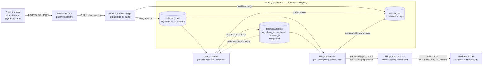

# Task 3.4, STEP 0: diagnóstico y propuesta (DETENTE 3.4.a)

Estado: preparado para revisión. No se ha escrito `docs/ARCHITECTURE.md`. Este informe no está en ningún commit.

## 1. Estado

- Rama `docs/phase3-architecture` en `ebe256f`, un commit por delante de `main` (`53a53a0`): el del briefing. Árbol limpio al empezar. Coincide con lo esperado.
- Leídos antes del inventario: `docs/internal/phase3_task3.3_closure_report.md` y `docs/internal/phase3_backlog.md`.

## 2. Inventario, leído del código

### 2.1 Componentes

| Componente | Código | Lenguaje | Cómo corre |
|---|---|---|---|
| Simulador de borde | `edge/simulator/` | Python 3.13.4 | proceso en el host, o `docker compose run` (perfil `simulator`) |
| Mosquitto | `broker/mosquitto/mosquitto.conf` | — | compose, núcleo |
| Bridge MQTT→Kafka | `bridge/mqtt_to_kafka/` (`__main__.py`, `validation.py`, `drop_monitor.py`) | Python | host, o contenedor (perfil `pipeline`) |
| Kafka + ZooKeeper + Schema Registry | `docker-compose.yml`; topics por `broker/kafka/provision.py` | — | compose, núcleo |
| Alarm consumer | `processing/alarm_consumer/` (`index.js`, `consumer.js`, `state_machine.js`, `config_loader.js`) | Node.js 24.16.0 | host, o contenedor (perfil `pipeline`) |
| ThingsBoard sink | `processing/thingsboard_sink/__main__.py` | Python | host, o contenedor (perfil `pipeline-tb`) |
| ThingsBoard | `processing/thingsboard/` (rule chains, dashboard); `scripts/thingsboard/import_rule_chains.py` | — | compose, perfil `full` |
| Firebase (opcional) | nodo REST "Firebase" en `processing/thingsboard/rule-chains/root-rule-chain.json` | — | dentro de ThingsBoard; podado si `FIREBASE_ENABLED` no es `true` |
| Logging común | `common/jsonlog.py`, `common/jsonlog.js` | ambos | librería |
| Configuración | `config/*.yaml`, `config/loader.py`, `processing/alarm_consumer/config_loader.js` | ambos | librería |

### 2.2 Versiones fijadas

- Imágenes (`docker-compose.yml`): `eclipse-mosquitto:2.1.2-alpine`, `confluentinc/cp-zookeeper:6.1.1`, `confluentinc/cp-server:6.1.1`, `confluentinc/cp-schema-registry:6.1.1`, `thingsboard/tb-postgres:4.2.1.1`.
- Imágenes propias (`docker/`): `python:3.13.4-slim-bookworm` y `node:24.16.0-bookworm-slim`, las dos fijadas por digest.
- Runtimes del host: `.python-version` 3.13.4, `.nvmrc` 24.16.0, `package.json` `engines.node` `>=24 <25`.
- Python (`requirements.txt`, solo dependencias directas): PyYAML 6.0.3, paho-mqtt 2.1.0, confluent-kafka[avro,schemaregistry] 2.15.1, fastavro 1.12.2. Las transitivas flotan (backlog, Task 3.6).
- Node (`package.json`, con `package-lock.json`): kafkajs 2.2.4, @kafkajs/confluent-schema-registry 4.1.0, yaml 2.9.1.
- CI: acciones fijadas por SHA, runner `ubuntu-24.04`.

### 2.3 Perfiles del compose y objetivos de make

- Núcleo (sin perfil): mosquitto, zookeeper, broker, schema-registry. `make up-core`, CI.
- `full`: añade thingsboard. `make up` (con aprovisionamiento e importación de rule chains).
- `pipeline`: bridge y alarm consumer en contenedores. `make up-pipeline-core`.
- `pipeline-tb`: el sink en contenedor, siempre con `full`. `make up-pipeline`.
- `simulator`: solo `docker compose run`.
- `firebase`: mencionado en el comentario de cabecera del compose; ningún servicio lo usa (hallazgo H6).
- Contenedores del pipeline: `read_only`, `cap_drop: [ALL]`, `no-new-privileges`, `init: true`, `stop_grace_period` 30 s, ningún puerto publicado. Sin política de reinicio en ningún servicio.
- Kafka y ZooKeeper en tmpfs (empiezan vacíos en cada arranque); ThingsBoard en volúmenes con nombre.

### 2.4 Topics (`config/topics.yaml`, creados solo por `broker/kafka/provision.py`; `KAFKA_AUTO_CREATE_TOPICS_ENABLE: "false"`)

| Topic | Clave | Partición | Particiones | RF | Política | Esquema |
|---|---|---|---|---|---|---|
| `telemetry.raw` | `asset_id` | por defecto (de la clave) | 3 | 1 | ninguna a nivel de topic: valores del broker | `telemetry_v1.avsc` |
| `telemetry.alarms` | `alarm_id` | murmur2 del `asset_id` (`AssetPartitioner`, `consumer.js:360-368`) | 3 | 1 | `cleanup.policy: compact`; `segment.ms` y demás, del broker | `alarm_v1.avsc` |
| `telemetry.dlq` | `asset_id` si se conoce | — (1 partición) | 1 | 1 | `delete`, `retention.ms` 604800000 (7 días) | `dlq_v1.avsc` |

MQTT: `plant/{asset_id}/telemetry`, suscripción `plant/+/telemetry`, QoS 1. `TELEMETRY_TOPIC` sustituye solo el nombre de `telemetry.raw` (los dos cargadores, con tests unitarios).

### 2.5 Esquemas Avro

Tres, todos versión 1, registrados por sus productores con el sujeto `<topic>-value`. Compatibilidad global `BACKWARD`, fijada y releída por `provision.py`. Política de versiones en `schemas/README.md`: cambio compatible en el mismo fichero; cambio incompatible, fichero `_v2` y topic nuevo; nombre de registro y namespace fijos; enums con `default`. Todos los registros de telemetría y alarmas llevan `synthetic`; la telemetría lleva además `injected_fault` (verdad de simulación).

### 2.6 Lógica de alarmas (`processing/alarm_consumer/state_machine.js`, `config/alarms.yaml`)

- Dos alarmas de nivel independientes por (activo, canal): HI en `warning` y HIHI en `critical`, cada una con su estado y su `alarm_id`.
- Dos estados, NORMAL y ACTIVE. Se levanta con valor ≥ umbral durante `persistence_samples` muestras seguidas; se borra con valor < umbral − histéresis durante `persistence_samples` muestras seguidas.
- Umbrales: temperatura 80/95 °C, histéresis 3, persistencia 3; vibración 4.5/7.1 mm/s, 0.3, 5; corriente por activo (105 % y 120 % de la nominal), histéresis 1, persistencia 5. `speed_rpm` no tiene alarma.
- Una muestra rompe la racha si hay un hueco en `seq`, si `seq` retrocede o si el valor es nulo o no finito: los contadores vuelven a cero y el estado no cambia.
- `alarm_id` = `asset_id/channel/severity/<ts de la muestra RAISED>`, determinista.
- Reconstrucción al arrancar (`consumer.js:158-200`, `index.js:163-173`): lee `telemetry.alarms` desde el principio hasta los offsets finales tomados al arrancar (60 s como máximo), se queda con el último evento por clave (un tombstone borra la clave) y marca ACTIVE los RAISED. **No reconstruye los contadores de persistencia ni el último `seq`** (hallazgo H3).
- ThingsBoard no evalúa umbrales: la rule chain AlarmMapping solo aplica RAISED/CLEARED, descarta un evento que no sea más nuevo que el último aplicado por activo y tipo, y lleva sus fallos a la rama Failure (`alarm_mapping_failed`).
- Reconciliación en `make up` (`reconcile_alarms`, `scripts/thingsboard/import_rule_chains.py`).

### 2.7 Sinks

- **ThingsBoard sink**: consume `telemetry.raw` y `telemetry.alarms` en su propio grupo; API MQTT de gateway con un token; un dispositivo por activo; telemetría con el `ts` de la muestra; cada evento de alarma bajo la clave `alarm_<channel>_<severity>`. Límite de 10 msg/s por activo (token bucket, `config/thingsboard.yaml`), acoplado a los retardos SQL de 25 ms del compose. Guarda el offset después del PUBACK de ThingsBoard. Lo transitorio se reintenta con backoff hasta 30 s; los tombstones se saltan y se cuentan; un registro de `telemetry.raw` que no se puede decodificar se salta (lo manda a la DLQ el alarm consumer); uno de `telemetry.alarms`, a la DLQ.
- **Cola de ThingsBoard**: PipelineSequential, creada por el script de importación: SEQUENTIAL_BY_ORIGINATOR, 60 s por lote, 20 reintentos de 5 s a 60 s.
- **Firebase**: ver la sección 3.

### 2.8 Logging

Líneas JSON en stderr, el mismo formato en Python y en Node (`ts`, `level`, `logger`, `event` y los campos aplanados). Los logs de librdkafka, kafkajs, los avisos de Python y los avisos de proceso de Node pasan por el mismo logger. Las diferencias conocidas entre los dos lenguajes están en la docstring de `common/jsonlog.py`, y un test de equivalencia las cubre (`tests/unit/test_jsonlog_equivalence.py`).

### 2.9 Métricas de latencia (solo definiciones, sin cifras)

- Bridge, una línea `message_delivered` por mensaje: `event_to_receive_ms`, `receive_to_produce_ms`, `produce_to_ack_ms`, `event_to_ack_ms`, `receive_ts_ms`. Cada campo dice qué reloj usa, y el error de truncado del `ts` es de 0 a 1 ms.
- Alarm consumer, en `alarm_raised`/`alarm_cleared`: `consume_to_alarm_ack_ms`, `event_to_alarm_ack_ms`, `alarm_ack_ts_ms`; `clockReading()` al arrancar y al terminar.

### 2.10 Monitor de descartes

`bridge/mqtt_to_kafka/drop_monitor.py`, con su propia conexión MQTT (`<client id>-drops`). Lee `$SYS/broker/publish/messages/dropped`: el valor retenido sirve de línea base, cada aumento se registra como `mqtt_messages_dropped` en ERROR, y un descenso cuenta como reinicio de Mosquitto. Si `$SYS/broker/uptime` calla 25 s, registra `mosquitto_sys_silent`. Se activa en `config/bridge.yaml`; si no puede suscribirse, el bridge no arranca. Contador de todo el broker, actualizado cada 10 s (`sys_interval`). La cola por cliente es de 60000 mensajes o 25 MiB, con la regla de dimensionado escrita en `mosquitto.conf`.

### 2.11 CI (`.github/workflows/ci.yml`)

Cuatro jobs:
- `checks`: lint y tests unitarios de los dos lenguajes, con cobertura de líneas y ramas ≥ 80 %.
- `integration`: integración sobre el núcleo.
- `integration-full`: con ThingsBoard; solo en push a main y en dispatch manual.
- `pipeline-containers`: smoke de 200 mensajes contra los contenedores.

Se ejecuta en cada push y en los PR a main. Sin reintentos.

## 3. Material ya redactado que se incorpora

Del backlog, sección "For Task 3.4", todo obligatorio:

1. El texto de garantías MQTT→Kafka aprobado en el DETENTE 3.3.h, **tal cual** (con la consulta de la decisión A3).
2. Un CLEARED se queda en el segmento activo hasta la siguiente escritura en su partición: la compactación no acota por tiempo. Hay que nombrar `segment.ms`, `min.cleanable.dirty.ratio` y `log.cleaner.backoff.ms`.
3. El contrato de `telemetry.alarms`: clave `alarm_id`, partición por activo. Las cartas muertas del consumer siguen la misma regla.
4. El PUBACK al simulador significa que Mosquitto aceptó el mensaje, no que lo recibiera el bridge. Incluye las tres ampliaciones del 2026-10-12: id de cliente repetido en el contenedor, reconexión automática y que el contador `$SYS` no ve esas pérdidas.
5. Los avisos de arranque, documentados y no filtrados: `AuthlibDeprecationWarning` y el de EoS de kafkajs.
6. El gráfico del dashboard une con una línea recta un periodo sin datos. No se puede configurar.
7. La reconciliación solo corre en `make up`, y un reinicio del broker sin ella deja alarmas fantasma.
8. La entrega en ThingsBoard: al menos una vez hasta el transporte MQTT, colas en memoria y PipelineSequential.
9. El techo del camino a ThingsBoard: 10 msg/s por activo, como **valor de configuración**. Las cifras medidas (6.9, 20.2, 43.1 msg/s) no entran por la regla de "ninguna cifra de rendimiento" (decisión A4).
10. Tras una caída de ThingsBoard, las alarmas nuevas esperan detrás del backlog. El cálculo de 7 a 60 minutos es una cifra y no entra (A4).
11. Las limitaciones del dashboard: sin contador de descartes de ThingsBoard, el contador de fallos de mapeo cuenta el mes natural y `alarm_mapping_failed` no lleva el texto del error.
12. `make run`: **ese objetivo no existe** (hallazgo H9).

## 4. Estructura propuesta de `docs/ARCHITECTURE.md`

| # | Sección | Qué responde |
|---|---|---|
| — | Cabecera | Qué es el sistema, en un párrafo, con el aviso de datos sintéticos visible antes de cualquier otra cosa. |
| 1 | Scope and synthetic data | Qué hace y qué no: un solo host, demostración local, sin seguridad de producción. Qué es sintético: los activos, los canales, los fallos inyectados y los campos `synthetic` e `injected_fault`. |
| 2 | System at a glance | El diagrama de flujo, con una línea por tramo. |
| 3 | Components | Tabla: componente, lenguaje, ruta en el repo, cómo corre (host o contenedor, perfil), entradas y salidas. |
| 4 | End-to-end data flow | El recorrido de una muestra: simulador, validación del bridge (las seis reglas, sin comprobación de rango), Avro, `telemetry.raw`, alarm consumer, `telemetry.alarms`, sink, rule chains y dashboard. Rutas a la DLQ. |
| 5 | Topics and schemas | Tabla de topics (2.4) y de esquemas. Política de versiones BACKWARD. El contrato de partición de `telemetry.alarms`. La compactación y el segmento activo. |
| 6 | Alarm logic | HI y HIHI, tabla de umbrales, persistencia, histéresis, rupturas de racha, `alarm_id`, diagrama de estados. Reconstrucción: qué recupera y qué no. ThingsBoard solo mapea. Reconciliación en `make up`. |
| 7 | Delivery guarantees, hop by hop | El texto aprobado de MQTT→Kafka. Kafka→alarm consumer→`telemetry.alarms` (al menos una vez, commit tras el ack, por qué no transacciones). Kafka→sink→ThingsBoard. Diagrama de secuencia. Tabla resumen por tramo. |
| 8 | Failure modes | Tabla: componente lento o caído, efecto y cómo se detecta (evento de log, código de salida, contador o lag). Cada fila lleva su evidencia; lo que solo sale de leer el código se marca así. |
| 9 | Configuration and deployment | Qué fichero de `config/` manda en qué, `.env`, perfiles, objetivos de make, la regla de no correr a la vez en el host y en contenedores, tmpfs frente a volúmenes, periodos de gracia (y el SIGTERM de ThingsBoard), tabla de versiones. |
| 10 | Observability | Formato de log, eventos clave por componente, definiciones de los campos de latencia, monitor de descartes, dashboard y contador de fallos de mapeo, estadísticas de cola de ThingsBoard, avisos de arranque. |
| 11 | Verification | Los cuatro jobs de CI y qué cubre cada uno; los tests de integración que prueban cada garantía (nombre del test). |
| 12 | Design decisions | Tabla: decisión, razón, alternativa descartada y evidencia. Ver la decisión A6. |
| 13 | Known limitations | Lista con referencia al backlog. Misma claridad que las capacidades. |
| 14 | Firebase (optional, inherited from the course) | Qué hace el nodo, cómo se activa y qué no se ha verificado (H5). |

La sección 11 la añado yo: el briefing pide CI en el inventario, y es la evidencia de la mayoría de las garantías.

## 5. Diagramas

**Formato: Mermaid embebido.**
- GitHub lo renderiza en el propio fichero.
- Se versiona como texto y se revisa en el diff.
- El test de sincronía puede leer sus nombres.

Un SVG exportado necesita una cadena de herramientas, no se puede revisar en un diff y se desincroniza en silencio. En contra de Mermaid: el aspecto depende de la versión de Mermaid que use GitHub, y fuera de GitHub (un editor de texto) se lee como código. Lo acepto: el texto del diagrama se entiende igual.

Tres diagramas:
1. **Flujo de datos** (`flowchart LR`), obligatorio. Borrador más abajo.
2. **Secuencia de entrega y acks** (`sequenceDiagram`), recomendado. En un solo dibujo se ve dónde ocurre cada PUBACK, cada `acks=all` y cada commit de offset, y dónde se pierde un mensaje si un componente cae. Es la garantía que más necesita un dibujo.
3. **Estados de una alarma de nivel** (`stateDiagram-v2`), recomendado: NORMAL y ACTIVE con las condiciones de los contadores. Es pequeño y la tabla de umbrales no lo sustituye.

**Comprobación del renderizado:**
1. Validación de sintaxis en local con `@mermaid-js/mermaid-cli`, ejecutado con `npx` desde el scratchpad. No se añade al repo.
2. Push de la rama y vista del fichero en github.com: captura con la extensión de Chrome si está disponible en tu sesión; si no, me lo confirmas tú (decisión A7). El repo es privado: la API `/markdown` de GitHub no renderiza Mermaid, así que no sirve como prueba.

Borrador del diagrama principal:

## 6. Test de sincronía

**Recomendación: sí, como test unitario de Python (`tests/unit/test_architecture_doc.py`) en el job `checks` que ya existe, sin job nuevo.** Corre en cada push, no necesita Docker y tarda menos de un segundo. Un job aparte añadiría unos 40 s de arranque del runner sin cubrir nada más. El briefing dice "con su job de CI": si lo quieres literal, lo hago como job propio (decisión A2).

**Alcance:**
- Las tablas de valores del documento, comparadas con su fuente:
  - topics (nombre, particiones, RF, `configs`) con `config.loader`;
  - umbrales, histéresis y persistencia con `config/alarms.yaml` a través del cargador;
  - límite del sink y ajustes del productor del bridge con `config/`;
  - imágenes y versiones con `docker-compose.yml`, `.python-version`, `.nvmrc`, `requirements.txt`, `package.json` y los `FROM` de `docker/`;
  - `max_queued_messages`, `max_queued_bytes` y `sys_interval` con `mosquitto.conf`.
- Que exista cada ruta del repo citada entre comillas invertidas en el documento.
- Que los nombres de topic de los diagramas Mermaid coincidan con `config/topics.yaml`.

**Mecanismo:** el test lee las tablas Markdown bajo encabezados fijos. No hay marcadores ocultos en el documento: lo que se comprueba es lo mismo que se lee.

**Costo:** unas 120-180 líneas de test, más tests de sus propias funciones de análisis para no bajar la cobertura de ramas. Estimado: unas 2 horas.

**Fuera de alcance:** la prosa. Que una frase describa bien el comportamiento lo cubre la tabla de trazabilidad, no este test.

## 7. Contradicciones y huecos encontrados

Ninguno se ha arreglado: el briefing prohíbe cambiar el producto. Cada uno indica qué haría con él en el documento.

- **H1. Precisión del texto aprobado (MQTT→Kafka).**
  - (a) "is logged as `message_delivery_failed`, and the run exits 1". En el código, el bridge sigue corriendo tras el fallo: el 1 es su código de salida cuando se detenga (`__main__.py:367-371` y `481-489`), no una salida inmediata.
  - (b) "A clean stop … processes and flushes everything received". El flush está acotado por `--flush-timeout`, 10 s por defecto (`__main__.py:145` y `473`); lo que quede pendiente se registra como `run_finished_incomplete` con salida 1.

  Las dos frases son ciertas en el caso normal, pero no son exactas. Decisión A3.
- **H2. La cola interna del bridge no tiene límite.** `self.inbox` es un `queue.Queue()` sin tamaño (`__main__.py:188`). El hilo de paho confirma el mensaje y lo encola aunque el hilo principal esté parado en `BufferError` (`_produce`, `313-321`), por ejemplo con Kafka caído. Lo que sale de leer el código: el bridge acumula en memoria sin límite y Mosquitto no ve ninguna congestión. El texto aprobado dice "held in memory until produced", sin decir que no hay límite. Ningún test lo ejercita. En el documento iría en modos de fallo, marcado como lectura del código, no verificado.
- **H3. La reconstrucción recupera estados, no contadores ni posición.**
  - Lo que se recupera: qué alarmas están ACTIVE, al final de `telemetry.alarms`.
  - Lo que no: los contadores de persistencia ni el último `seq`. El consumo se reanuda en el último offset confirmado de `telemetry.raw`, que puede ser anterior.
  - Efecto cierto: tras un reinicio, un levantamiento o un borrado pendiente se retrasa hasta `persistence_samples − 1` muestras.
  - Efecto posible, no verificado: al reprocesar muestras anteriores a un RAISED ya restaurado como ACTIVE, se podría emitir un CLEARED espurio si esas muestras cumplen la condición de borrado.
  - El comentario de `consumer.js:24-27`, "duplicates … carry the same deterministic alarm_id", supone que el reproceso da las mismas transiciones.

  En el documento: escribir lo que se recupera y lo que no; el efecto posible, como hueco abierto.
- **H4. El alarm consumer solo admite una instancia.** El estado está en memoria por activo y la reconstrucción solo ocurre al arrancar. Un segundo consumidor en el mismo grupo se repartiría las particiones de `telemetry.raw` sin traspasar estado, y en cada rebalanceo los activos cambiarían de dueño. Ningún fichero lo dice. En el documento: limitación.
- **H5. El nodo Firebase.**
  - (a) Envía cada mensaje "Post telemetry" de **cualquier** dispositivo con `PUT ${FIREBASE_DB_URL}/temperature.json` (`root-rule-chain.json`, nodo 7): cada mensaje sobrescribe la misma ruta.
  - (b) `FIREBASE_DB_SECRET` está en `.env.example:49` y nada lo lee: la llamada va sin autenticación, así que solo funcionaría contra una base con reglas abiertas.
  - (c) El script de importación lo dice él mismo: verificado solo hasta la URL escrita en ThingsBoard, nunca contra una base real.

  En el documento: escrito tal cual, como sink heredado y sin verificar.
- **H6. El perfil `firebase` no existe.** El comentario del compose (`docker-compose.yml:20-21`) lo reserva "for the optional Firebase sink, which … has no service yet", pero el sink de Firebase existe y es un nodo de ThingsBoard, no un servicio. En el documento se describe lo real y no se menciona el perfil.
- **H7. El sink escribe en la DLQ, pero dos descripciones no lo recogen.** El sink escribe con `source: thingsboard_sink`, y aun así:
  - `dlq_v1.avsc` (campo `source`) dice "bridge or alarm_consumer";
  - `config/topics.yaml:37` dice "the bridge or the alarm consumer".

  En el documento se describe lo real y queda como hallazgo. Corregir el `doc` del esquema registra una versión nueva del sujeto.
- **H8. `telemetry.raw` y `telemetry.alarms` usan los valores del broker para retención, `segment.ms` y `min.cleanable.dirty.ratio`.** Ningún fichero del repo los fija, y solo el test los ajusta (`test_restore_compaction.py:37`). Con Kafka en tmpfs, además, los datos no sobreviven a un reinicio del contenedor. El backlog pide nombrar estos ajustes, pero sus valores no se pueden "señalar en el repo". Decisión A5.
- **H9. `make run` no existe.** El backlog habla de "`make run` keeps the pipeline running"; el Makefile no tiene ese objetivo. Lo equivalente es `make up-pipeline`: los contenedores corren sin `--duration`. En el documento se cita `make up-pipeline`.
- **H10. La opción B (Kafka persistente) sigue sin decidirse.** El backlog pedía reconsiderarla en el STEP 0 de la 3.3. Allí la D4 resolvió solo el benchmark (tmpfs) y dejó escrito "la persistencia de producción se decide aparte" (`benchmark_protocol_proposal.md:282` y `:400`). En "Design decisions", tmpfs aparecería como decisión en vigor con la razón de la Fase 0 (`docker-compose.yml:66-70`), y la opción B como alternativa abierta, no descartada.
- **H11. El bridge con Schema Registry caído, sin verificar.** El bridge registra los esquemas al arrancar; no sé si el `AvroSerializer` vuelve a consultar el registro después. Ningún test cubre ese caso (`test_schema_registry_down` es el del consumer). En el documento, la fila de modos de fallo diría "not verified".

## 8. Decisiones que necesito de ti

- **A1.** ¿Apruebas la estructura de la sección 4, incluida la sección 11 "Verification", que añado yo?
- **A2.** El test de sincronía: ¿sí, con el alcance de la sección 6? ¿Dentro del job `checks` (mi recomendación) o en un job propio, como dice el briefing?
- **A3.** El texto aprobado de garantías (H1): ¿lo copio literal o con dos precisiones? Las precisiones serían: "the bridge's exit status is 1 when it stops" y "flushes … for up to `--flush-timeout` (10 s); anything left is logged as `run_finished_incomplete`".
- **A4.** La regla de "ninguna cifra de rendimiento" frente al backlog, que pide documentar el techo del camino a ThingsBoard y el drenaje tras una caída. Propuesta: el documento da solo el valor configurado (10 msg/s por activo), el acoplamiento con los retardos SQL y el comportamiento (las alarmas nuevas esperan detrás del backlog), sin 6.9, 20.2 ni el cálculo de 7 a 60 minutos. ¿De acuerdo?
- **A5.** Los ajustes que salen del broker (H8):
  - (a) consultarlos en vivo en el STEP 1 (`kafka-configs --describe --all`) y citar el comando y su salida en la tabla de trazabilidad;
  - (b) nombrarlos sin valor ("broker default, not set in this repository");
  - (c) fijarlos en `config/topics.yaml`, que es un cambio de producto y queda fuera de esta tarea.

  Recomiendo (a).
- **A6.** "Design decisions" necesita la razón de cada decisión, y para varias no está en el repo:
  - por qué Confluent 6.1.1 con ZooKeeper y cp-server (y no cp-kafka ni KRaft);
  - por qué Node.js para el alarm consumer;
  - por qué ThingsBoard 4.2.1.1.

  ¿Me das la razón, o escribo "inherited from the course stack, not re-evaluated" donde sea el caso? Sin una de las dos, la fila no se escribe.
- **A7.** El renderizado en GitHub (repo privado): ¿uso la extensión de Chrome con tu sesión para abrir el fichero en la rama y capturarlo, o lo compruebas tú?
- **A8.** Los hallazgos H2-H7 y H11: ¿entran todos en "Known limitations" o en modos de fallo, tal como propongo? ¿Abro un elemento de backlog para cada uno de H2, H3, H4, H5, H6 y H7, en `docs/internal/phase3_backlog.md`?
